# DOKUMEN ANALISIS DAN PERANCANGAN SISTEM MOTOCARE
**Aplikasi Motorcycle Care (Layanan Bantuan Montir & Perawatan Motor)**  
*Tahap: Analisis Sistem (Minggu 6–7)*  
*Wilayah Layanan: Kota Lhokseumawe dan Kabupaten Aceh Utara*  
*Target Platform: Android (Flutter & Supabase / Mock Architecture)*

---

## 1. Gambaran Umum Sistem

**MotoCare (Motorcycle Care)** merupakan aplikasi berbasis *mobile* yang dirancang untuk membantu pengendara sepeda motor mendapatkan bantuan mekanik ketika mengalami kerusakan atau kendala di perjalanan. Aplikasi ini berfokus pada layanan pemanggilan montir berdasarkan lokasi pengguna, terutama ketika pengguna mengalami masalah di daerah yang jauh dari bengkel.

MotoCare juga menyediakan fitur pendukung berupa:
1. **Pencarian Bengkel Terdekat**: Menggunakan Google Maps Platform untuk direktori bengkel di wilayah Kota Lhokseumawe dan Kabupaten Aceh Utara.
2. **Pengelolaan Data Kendaraan**: Manajemen multi-kendaraan dengan pencatatan merek, model, tahun, pelat nomor, dan pembaruan kilometer berkala.
3. **Pencatatan Riwayat Servis**: Pencatatan log servis berkala, komponen yang diganti, serta rincian biaya jasa dan suku cadang.
4. **Pengingat Perawatan & Notifikasi**: Pengingat berbasis kalender dan kilometer (*mileage threshold*), serta notifikasi *in-app* untuk perubahan status pemanggilan montir.
5. **Tutorial Perawatan Motor**: Panduan edukasi servis mandiri melalui kurasi video YouTube resmi beserta peringatan keselamatan kerja.

Aplikasi dirancang menggunakan pendekatan **Object-Oriented Programming (OOP)**, arsitektur *Clean Architecture / Feature-First*, antarmuka modern dengan font *Plus Jakarta Sans*, dominasi warna putih, gradasi oranye muda (*Warm Coral* `#FF5733`), dan abu-abu arang modern (`#2D3142`).

---

## 2. Analisis Permasalahan dan Solusi

### 2.1 Analisis Permasalahan
1. **Kendala Darurat di Perjalanan**: Pengendara motor kerap mengalami mogok, ban bocor, atau rantai putus di lokasi yang jauh dari pemukiman dan bengkel konvensional.
2. **Kesulitan Mendapatkan Mekanik Panggilan**: Belum ada sistem terpadu untuk menghubungkan pengendara dengan mekanik yang bersedia datang ke lokasi kejadian di wilayah Lhokseumawe dan Aceh Utara.
3. **Ketidakpastian Biaya dan Status**: Kurangnya transparansi mengenai estimasi biaya perbaikan dan ketidakpastian apakah mekanik sedang menuju ke lokasi.
4. **Disorientasi Lokasi Bengkel**: Pengendara yang sedang melintas di jalur lintas Sumatra sering tidak mengetahui bengkel terdekat yang masih buka.
5. **Kelalaian Perawatan Berkala**: Pengendara sering lupa mengganti oli mesin, kampas rem, atau transmisi CVT karena ketiadaan catatan riwayat dan pengingat kilometer.

### 2.2 Solusi yang Ditawarkan
- **Fitur Utama (Panggil Montir)**: Memungkinkan pengguna mengajukan permintaan darurat dengan deteksi lokasi GPS otomatis atau input manual, memilih jenis kendala, dan memantau status secara *real-time* (*Menunggu*, *Diterima*, *Ditolak*, *Sedang Ditangani*, *Selesai*).
- **Fitur Pendukung Terpadu**: Direktori bengkel lokal terverifikasi, pencatatan servis terpadu dengan odometer otomatis, pengingat preventif berbasis odometer, serta video tutorial edukasi.
- **Kepatuhan Data & Simulasi**: Selama tahap pengembangan, mekanik dan data simulasi diberi label eksplisit *"Demo / Simulasi"* agar tidak menyesatkan pengguna.

---

## 3. Analisis Kebutuhan Sistem

### 3.1 Kebutuhan Fungsional (Functional Requirements)
- **FR-01 (Autentikasi & Akun)**: Registrasi akun baru, login berbasis peran (Pemilik Kendaraan, Mekanik, Admin), verifikasi kredensial, dan manajemen profil.
- **FR-02 (Panggil Montir - Core)**: Pengajuan bantuan montir darurat, deteksi koordinat GPS kejadian, pemilihan motor, pemilihan jenis kendala, input deskripsi kerusakan, dan alur konfirmasi mekanik.
- **FR-03 (Pencarian Bengkel)**: Menampilkan daftar dan peta bengkel di Kota Lhokseumawe dan Kab. Aceh Utara, navigasi rute eksternal (*Google Maps*), dan informasi kontak/jam operasional.
- **FR-04 (Manajemen Kendaraan)**: CRUD data sepeda motor (merek, model, tahun produksi, nomor pelat, odometer kilometer) serta konfirmasi koreksi kilometer.
- **FR-05 (Riwayat Servis & Biaya)**: Pencatatan tanggal servis, kilometer saat servis, kategori tindakan, rincian biaya suku cadang dan jasa, serta sinkronisasi ke kilometer kendaraan.
- **FR-06 (Pengingat Servis & Notifikasi)**: Penjadwalan pengingat servis otomatis berbasis tanggal atau batas kilometer, serta pusat notifikasi *in-app*.
- **FR-07 (Tutorial Perawatan)**: Katalog tutorial berbasis kategori (oli, rem, aki, ban, rantai, mesin) dengan tautan video YouTube resmi dan peringatan keselamatan (*safety warning*).
- **FR-08 (Kelola Mekanik - Admin)**: Administrator dapat mengelola pendaftaran, spesialisasi keahlian, wilayah jangkauan, dan status ketersediaan mekanik.

### 3.2 Kebutuhan Nonfungsional (Non-Functional Requirements)
- **Usability**: UI intuitif berbasis palet putih-oranye (*Warm Coral*), tombol CTA Panggil Montir terlihat menonjol di *Home*, tipografi Plus Jakarta Sans.
- **Performance**: Waktu respon halaman lokal < 1 detik, indikator skeleton loading, durasi splash screen 3–5 detik.
- **Security & Privacy**: Otorisasi data berbasis peran dan kepemilikan (*Supabase Row Level Security / RLS*), izin akses lokasi GPS hanya saat aplikasi digunakan, enkripsi kata sandi.
- **Reliability**: Penanganan *offline fallback*, validasi input form sebelum kirim, pembatalan permintaan montir otomatis jika batas waktu 15 menit tercapai tanpa respon (*timeout*).
- **Service Boundary**: Pembatasan wilayah layanan ketat pada Kota Lhokseumawe dan Kabupaten Aceh Utara.

---

## 4. Analisis Pengguna dan Aktor

| Aktor | Deskripsi Peran | Hak Akses Utama |
| :--- | :--- | :--- |
| **Pemilik Kendaraan** | Pengguna umum pengendara motor di wilayah Lhokseumawe & Aceh Utara | Registrasi/Login, memanggil montir, mencari bengkel, mengelola motor & riwayat servis, menerima pengingat. |
| **Mekanik** | Penyedia jasa servis panggilan yang terdaftar | Login, menerima/menolak panggilan montir darurat, memberikan estimasi biaya, memperbarui status penanganan, menandai servis selesai. |
| **Admin** | Pengelola sistem dan verifikator operasional | Login, mengelola data mekanik, memverifikasi bengkel rekanan, memantau riwayat layanan. |

---

## 5. Use Case Modeling

### 5.1 Use Case Diagram
Berikut diagram interaksi antar-aktor dengan modul use case sistem MotoCare:

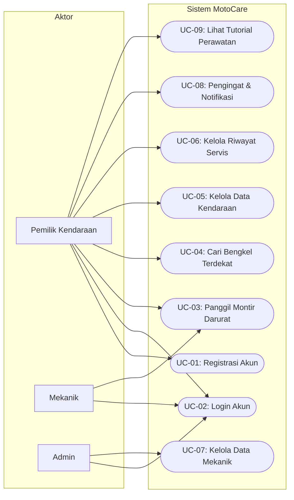

---

### 5.2 Skenario Use Case Lengkap

#### UC-01: Skenario Registrasi Akun
| Identifikasi | Rincian |
| :--- | :--- |
| **No Use Case** | UC-01 |
| **Nama** | Registrasi Akun |
| **Tujuan** | Mendaftarkan akun pengguna baru ke dalam sistem MotoCare |
| **Aktor** | Pemilik Kendaraan |
| **Kondisi Awal** | Aplikasi menampilkan halaman Registrasi |
| **Kondisi Akhir** | Akun tersimpan dan diarahkan ke halaman Login |

**Skenario Utama**:
| Aksi Aktor | Reaksi Sistem |
| :--- | :--- |
| 1. Membuka halaman registrasi | 2. Menampilkan formulir pendaftaran akun |
| 3. Mengisi nama lengkap, email, dan kata sandi | 4. Melakukan validasi format data |
| 5. Menekan tombol "Daftar Sekarang" | 6. Menyimpan akun baru ke basis data |
|  | 7. Menampilkan pesan registrasi berhasil dan mengarahkan ke halaman Login |

**Skenario Alternatif**:
| Skenario Alternatif | Reaksi Sistem |
| :--- | :--- |
| 4a. Format email salah atau password kurang dari 8 karakter | Sistem menampilkan pesan validasi spesifik di bawah *text field*. |
| 4b. Email sudah terdaftar di sistem | Sistem menampilkan pesan kesalahan "Email sudah digunakan" dan meminta pengguna menggunakan email lain atau login. |

---

#### UC-02: Skenario Login Akun
| Identifikasi | Rincian |
| :--- | :--- |
| **No Use Case** | UC-02 |
| **Nama** | Login Akun |
| **Tujuan** | Memverifikasi identitas pengguna untuk mengakses sistem |
| **Aktor** | Pemilik Kendaraan, Mekanik, Admin |
| **Kondisi Awal** | Aplikasi menampilkan form login |
| **Kondisi Akhir** | Pengguna berhasil masuk dan dashboard ditampilkan sesuai peran |

**Skenario Utama**:
| Aksi Aktor | Reaksi Sistem |
| :--- | :--- |
| 1. Membuka halaman login | 2. Menampilkan form input email dan kata sandi |
| 3. Memasukkan email dan kata sandi | 4. Memverifikasi kredensial akun |
| 5. Menekan tombol "Masuk" | 6. Menginisialisasi sesi pengguna |
|  | 7. Menampilkan halaman utama sesuai peran aktor (Dashboard Pemilik / Mekanik / Admin) |

**Skenario Alternatif**:
| Skenario Alternatif | Reaksi Sistem |
| :--- | :--- |
| 4a. Email atau password tidak cocok | Sistem menampilkan pesan peringatan "Email atau kata sandi tidak valid" dan tetap di halaman login. |

---

#### UC-03: Skenario Panggil Montir
| Identifikasi | Rincian |
| :--- | :--- |
| **No Use Case** | UC-03 |
| **Nama** | Panggil Montir Darurat |
| **Tujuan** | Mengirimkan permintaan montir darurat ke lokasi kerusakan kendaraan |
| **Aktor** | Pemilik Kendaraan, Mekanik |
| **Kondisi Awal** | Pemilik kendaraan telah login dan berada di halaman utama |
| **Kondisi Akhir** | Permintaan tersimpan, dikonfirmasi mekanik, dan status terpantau |

**Skenario Utama**:
| Aksi Aktor | Reaksi Sistem |
| :--- | :--- |
| 1. Memilih menu / tombol "Panggil Montir" di halaman utama | 2. Menampilkan formulir permintaan dan meminta izin akses lokasi (GPS) |
| 3. Memilih motor, kategori kendala, lokasi, dan mengisi deskripsi | 4. Memvalidasi data dan mencari mekanik yang tersedia di wilayah jangkauan |
| 5. Menekan tombol "Kirim Permintaan Bantuan" | 6. Menyimpan permintaan dengan status `MENUNGGU` dan meneruskannya ke antrean mekanik |
| 7. Memantau status permintaan di layar pantau | 8. Mekanik menerima permintaan dengan estimasi biaya; status berubah menjadi `DITERIMA` |
| 9. Menunggu mekanik melakukan perbaikan di lokasi | 10. Mekanik menandai perbaikan selesai; status berubah menjadi `SELESAI` |
| 11. (Opsional) Memberikan ulasan dan penilaian | 12. Menyimpan ulasan ke sistem |

**Skenario Alternatif**:
| Skenario Alternatif | Reaksi Sistem |
| :--- | :--- |
| 4a. Data tidak lengkap atau tidak ada mekanik tersedia | Menampilkan pesan "Mekanik belum tersedia di area Anda" dan menyarankan mencari bengkel terdekat. |
| 8a. Mekanik menolak permintaan | Sistem mengubah status menjadi `DITOLAK`, mengirim notifikasi penolakan beserta alasan ke pemilik kendaraan. |
| 8b. Tidak ada respon dalam 15 menit (timeout) | Sistem mengubah status menjadi `KEDALUWARSA` dan menyajikan alternatif tombol darurat / bengkel terdekat. |

---

#### UC-04: Skenario Cari Bengkel Terdekat
| Identifikasi | Rincian |
| :--- | :--- |
| **No Use Case** | UC-04 |
| **Nama** | Cari Bengkel Terdekat |
| **Tujuan** | Menemukan bengkel motor resmi/umum di wilayah Lhokseumawe dan Aceh Utara |
| **Aktor** | Pemilik Kendaraan |
| **Kondisi Awal** | Pengguna membuka menu "Bengkel" |
| **Kondisi Akhir** | Daftar dan detail bengkel ditampilkan serta dapat dibuka di peta |

**Skenario Utama**:
| Aksi Aktor | Reaksi Sistem |
| :--- | :--- |
| 1. Memilih menu "Bengkel Terdekat" | 2. Meminta izin GPS dan membaca koordinat pengguna |
| 3. Memfilter bengkel berdasarkan radius atau kata kunci | 4. Mengambil data tempat bengkel sesuai cakupan wilayah layanan |
| 5. Melihat daftar bengkel dan peta | 6. Menampilkan kartu bengkel lengkap (nama, alamat, rating, jam buka) |
| 7. Memilih salah satu bengkel | 8. Menampilkan detail kontak, layanan servis, dan tombol petunjuk arah |
| 9. Menekan tombol "Petunjuk Arah" | 10. Membuka navigasi rute melalui Google Maps eksternal |

**Skenario Alternatif**:
| Skenario Alternatif | Reaksi Sistem |
| :--- | :--- |
| 2a. Layanan GPS tidak diizinkan atau dinonaktifkan | Sistem menampilkan prompt lokasi dan memungkinkan filter berdasarkan kota/kecamatan manual. |
| 4a. Lokasi berada di luar Lhokseumawe dan Aceh Utara | Sistem menampilkan pesan informasi bahwa lokasi saat ini di luar cakupan layanan MotoCare. |

---

#### UC-05: Skenario Kelola Data Kendaraan
| Identifikasi | Rincian |
| :--- | :--- |
| **No Use Case** | UC-05 |
| **Nama** | Kelola Data Kendaraan |
| **Tujuan** | Menambah, mengubah, dan menghapus data sepeda motor pengguna |
| **Aktor** | Pemilik Kendaraan |
| **Kondisi Awal** | Pengguna berada di menu "Motor Saya" |
| **Kondisi Akhir** | Data kendaraan tersimpan dan daftar kendaraan terbarui |

**Skenario Utama**:
| Aksi Aktor | Reaksi Sistem |
| :--- | :--- |
| 1. Membuka menu "Motor Saya" | 2. Menampilkan daftar sepeda motor terdaftar |
| 3. Memilih "Tambah Motor" | 4. Menampilkan formulir input kendaraan |
| 5. Mengisi merek, model, tahun pembuatan, nomor pelat, dan kilometer | 6. Memvalidasi data yang dimasukkan |
| 7. Menekan "Simpan" | 8. Menyimpan data motor dan memperbarui tampilan daftar motor |
| 9. (Alternatif Edit) Memilih motor dan mengubah data | 10. Memvalidasi dan memperbarui data motor |
| 11. (Alternatif Hapus) Menekan tombol hapus motor | 12. Menampilkan dialog konfirmasi penghapusan |
| 13. Mengonfirmasi hapus | 14. Menghapus motor dari database dan memperbarui daftar motor |

**Skenario Alternatif**:
| Skenario Alternatif | Reaksi Sistem |
| :--- | :--- |
| 6a. Kilometer yang dimasukkan lebih rendah dari catatan sebelumnya | Sistem memunculkan dialog konfirmasi koreksi odometer sebelum menyimpan. |

---

#### UC-06: Skenario Kelola Riwayat Servis
| Identifikasi | Rincian |
| :--- | :--- |
| **No Use Case** | UC-06 |
| **Nama** | Kelola Riwayat Servis & Biaya |
| **Tujuan** | Mencatat dan memantau riwayat servis serta pengeluaran biaya perawatan |
| **Aktor** | Pemilik Kendaraan |
| **Kondisi Awal** | Pengguna berada di menu "Riwayat Servis" |
| **Kondisi Akhir** | Catatan servis baru tersimpan dan odometer motor terupdate |

**Skenario Utama**:
| Aksi Aktor | Reaksi Sistem |
| :--- | :--- |
| 1. Membuka menu "Riwayat Servis" | 2. Menampilkan daftar riwayat servis berdasarkan motor |
| 3. Memilih tombol "Catat Servis Baru" | 4. Menampilkan formulir pencatatan servis |
| 5. Mengisi tanggal servis, kilometer saat servis, rincian tindakan, biaya jasa, dan suku cadang | 6. Memvalidasi kelengkapan form |
| 7. Menekan tombol "Simpan Riwayat" | 8. Menyimpan riwayat servis ke database dan menyinkronkan kilometer terbaru ke data motor |
|  | 9. Menampilkan kembali daftar riwayat servis yang sudah terbarui |

---

#### UC-07: Skenario Kelola Data Mekanik (Admin)
| Identifikasi | Rincian |
| :--- | :--- |
| **No Use Case** | UC-07 |
| **Nama** | Kelola Data Mekanik |
| **Tujuan** | Mengelola profil, wilayah jangkauan, dan keahlian mekanik rekanan |
| **Aktor** | Administrator |
| **Kondisi Awal** | Admin berada di menu manajemen mekanik |
| **Kondisi Akhir** | Data mekanik tersimpan, terbarui, atau dihapus |

**Skenario Utama**:
| Aksi Aktor | Reaksi Sistem |
| :--- | :--- |
| 1. Membuka menu manajemen data mekanik | 2. Menampilkan daftar mekanik yang terdaftar |
| 3. Memilih "Tambah Mekanik" | 4. Menampilkan formulir data profil mekanik |
| 5. Mengisi nama, keahlian khusus, nomor kontak, dan wilayah operasional | 6. Memvalidasi format isian data |
| 7. Menekan tombol "Simpan" | 8. Menyimpan data mekanik baru dan menyegarkan daftar |
| 9. (Opsi Edit) Memilih mekanik, mengubah status atau keahlian | 10. Memperbarui data mekanik |
| 11. (Opsi Hapus) Memilih mekanik dan menekan hapus | 12. Meminta konfirmasi dan menghapus data mekanik |

---

## 6. Activity Diagram Modeling

Berikut adalah 7 Activity Diagram lengkap untuk seluruh alur aktivitas utama sistem MotoCare.

### 6.1 Activity Diagram Registrasi

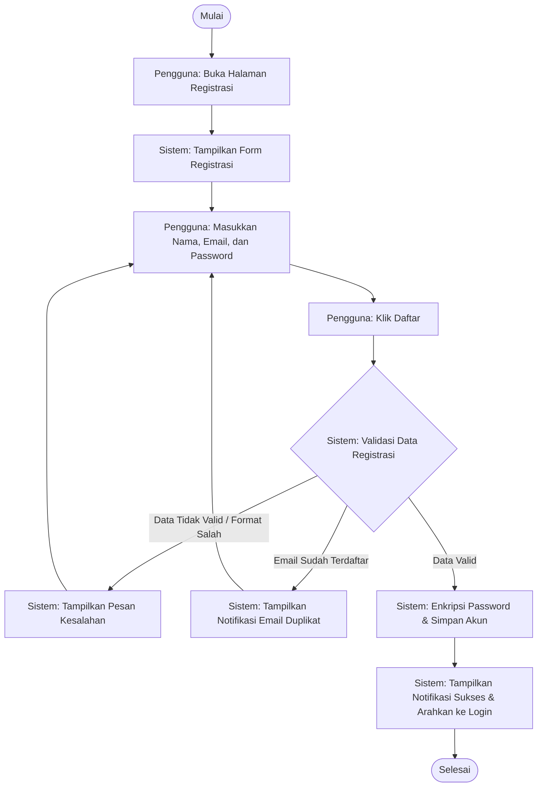

---

### 6.2 Activity Diagram Login

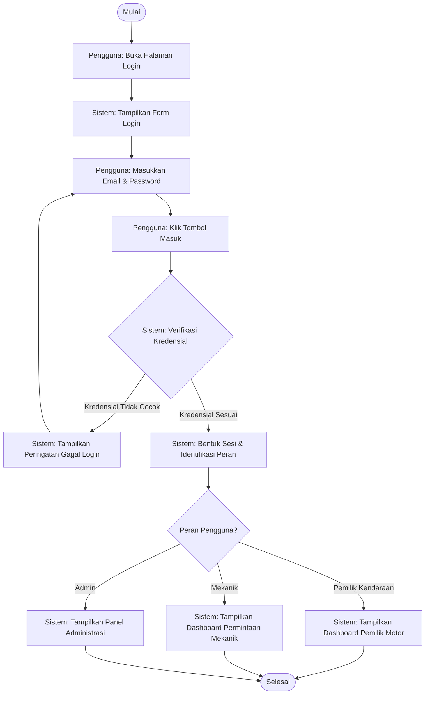

---

### 6.3 Activity Diagram Panggil Montir (Fitur Utama)

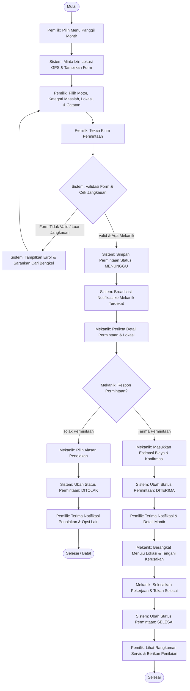

---

### 6.4 Activity Diagram Cari Bengkel Terdekat

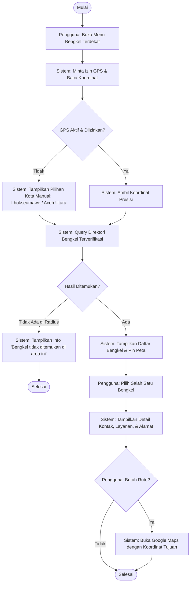

---

### 6.5 Activity Diagram Data Kendaraan

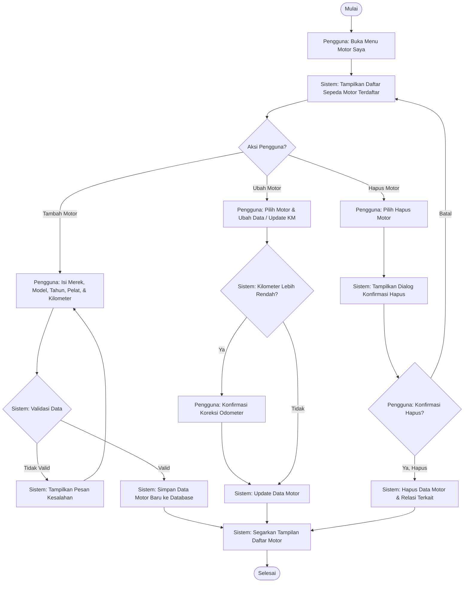

---

### 6.6 Activity Diagram Riwayat Servis

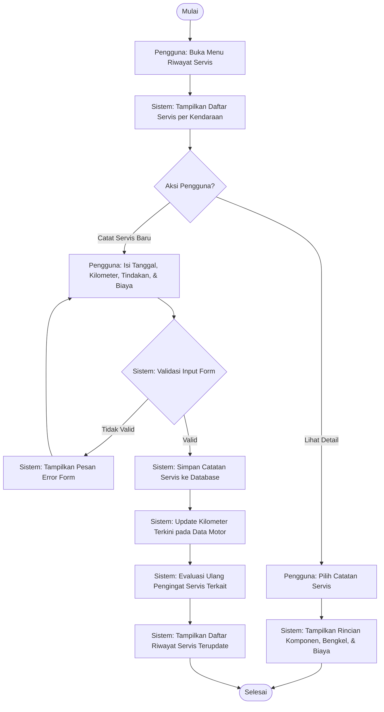

---

### 6.7 Activity Diagram Data Mekanik (Admin)

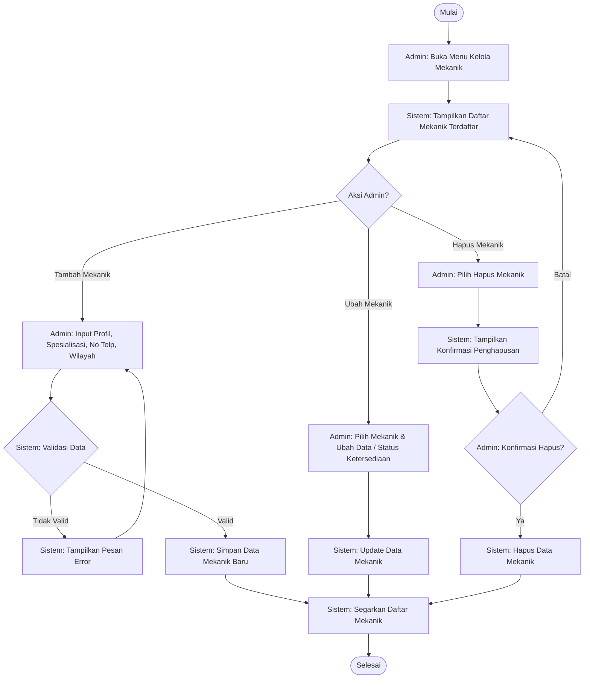

---

## 7. Sequence Diagram Modeling

Berikut adalah 7 Sequence Diagram MotoCare yang menggambarkan interaksi dinamis aktor dan sistem berdasarkan urutan waktu.

### 7.1 Sequence Diagram Registrasi
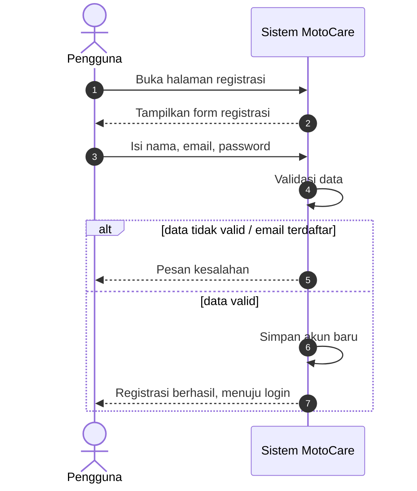

---

### 7.2 Sequence Diagram Login
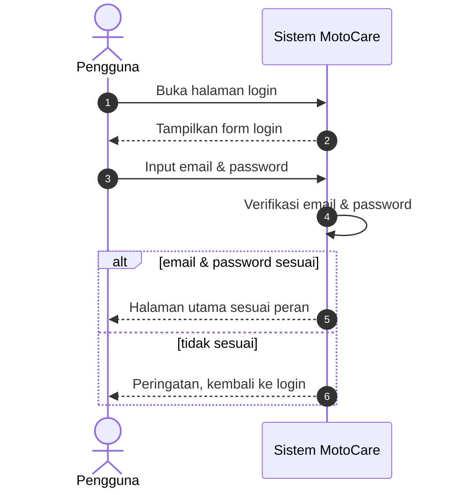

---

### 7.3 Sequence Diagram Panggil Montir
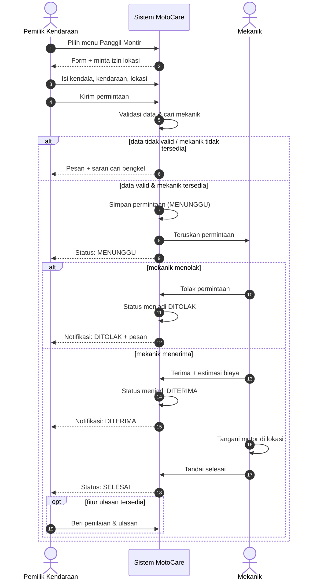

---

### 7.4 Sequence Diagram Cari Bengkel Terdekat
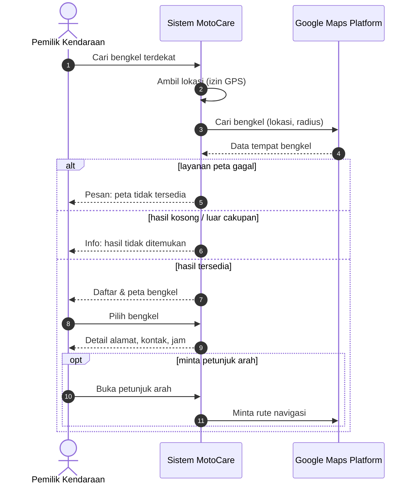

---

### 7.5 Sequence Diagram Data Kendaraan
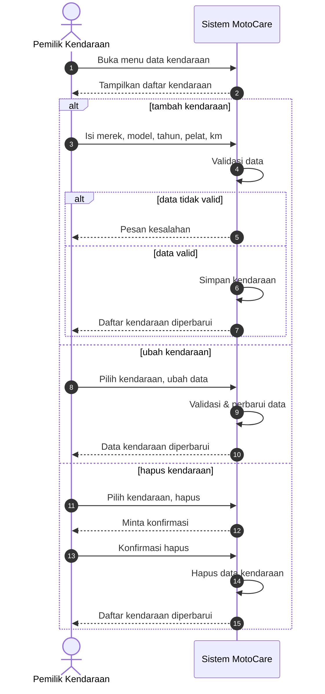

---

### 7.6 Sequence Diagram Riwayat Servis
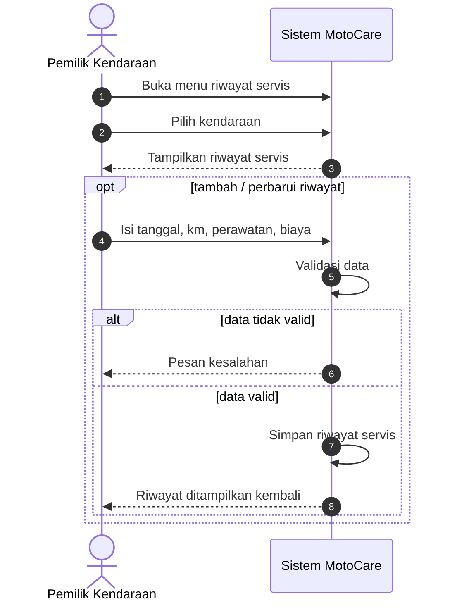

---

### 7.7 Sequence Diagram Data Mekanik (Admin)
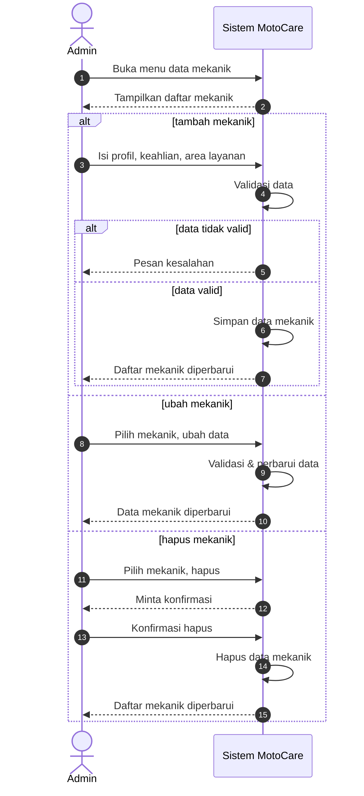

---

## 8. Pemetaan ke Implementasi OOP & Arsitektur Kode MotoCare

Seluruh spesifikasi dalam analisis sistem ini terhubung langsung dengan kode aplikasi Flutter di repositori `MOTOCARE`:

1. **Struktur Berbasis Fitur (*Feature-First*)**:
   - `lib/features/auth/`: Mengimplementasikan UC-01 & UC-02 (Registrasi, Login, Profile).
   - `lib/features/help_requests/`: Mengimplementasikan UC-03 (Panggil Montir, alur status `MENUNGGU` -> `DITERIMA` -> `SELESAI`, kalkulasi kedaluwarsa 15 menit).
   - `lib/features/workshops/`: Mengimplementasikan UC-04 (Pencarian bengkel Lhokseumawe & Aceh Utara, integrasi peta eksternal).
   - `lib/features/motorcycles/`: Mengimplementasikan UC-05 (CRUD motor, validasi penurunan odometer).
   - `lib/features/service_history/`: Mengimplementasikan UC-06 (Catatan servis, biaya Rupiah, sinkronisasi km).
   - `lib/features/reminders/` & `notifications/`: Pengingat servis cerdas & notifikasi status.
   - `lib/features/tutorials/`: Edukasi tutorial video YouTube terkurasi.

2. **Pola Data Repository (Polimorfisme & Abstraksi)**:
   - Setiap fitur memiliki kontrak abstrak (misal `HelpRequestRepository`, `MotorcycleRepository`).
   - Implementasi ganda: `Mock*Repository` (untuk simulasi/pengujian) dan `Supabase*Repository` (untuk database live).
   - Seluruh data simulasi diberi label `[Demo/Simulasi]` sesuai mandat analisis kebutuhan.

3. **Keamanan & Konsistensi Data**:
   - Validasi sisi klien di `lib/core/utils/validators.dart`.
   - Validasi otorisasi sisi server ditegakkan melalui *Row Level Security (RLS)* di `supabase/migrations/`.

---

## 9. Kesimpulan

Dokumen Analisis Sistem MotoCare telah dirampungkan secara komprehensif, mencakup:
1. Analisis permasalahan dan solusi sistem bantuan darurat sepeda motor di Lhokseumawe dan Aceh Utara.
2. Spesifikasi kebutuhan fungsional (FR) dan non-fungsional (NFR).
3. Permodelan UML lengkap yang terdiri dari:
   - **Use Case Diagram** dan **7 Tabel Skenario Use Case Rinci**.
   - **7 Activity Diagram** terstruktur dengan alur keputusan (decision nodes) yang lengkap.
   - **7 Sequence Diagram** yang mencerminkan interaksi dinamis antara aktor, sistem, dan layanan peta Google Maps Platform.
4. Keselarasan penuh antara dokumen analisis dan implementasi kode sumber Flutter MotoCare pada repositori.

