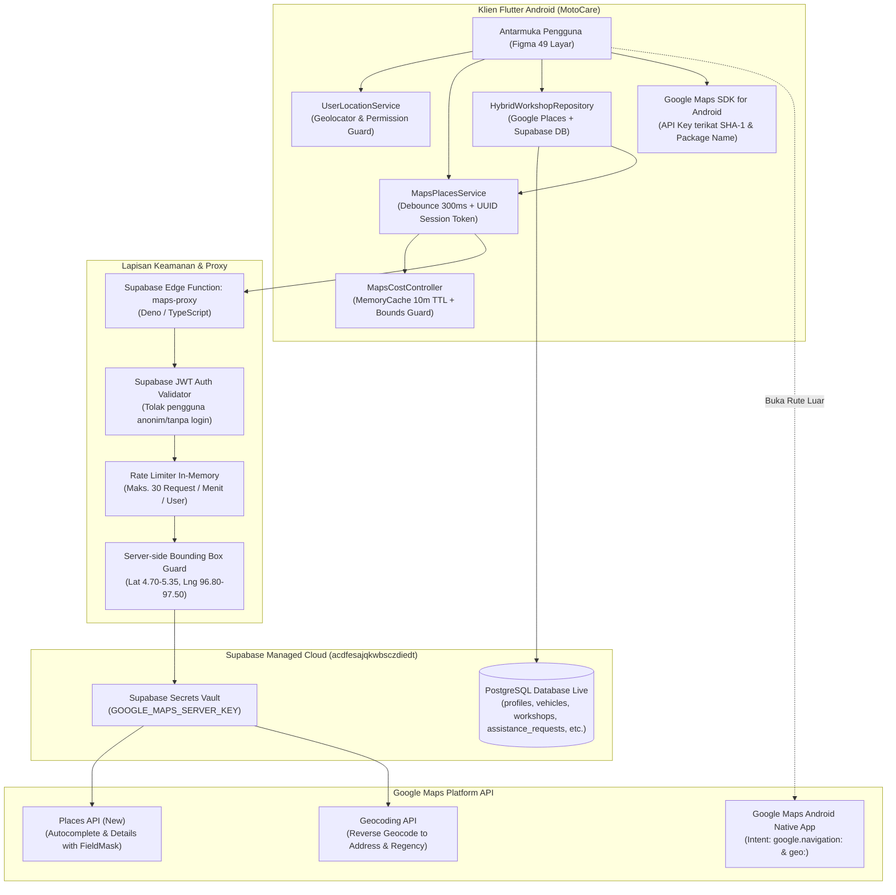
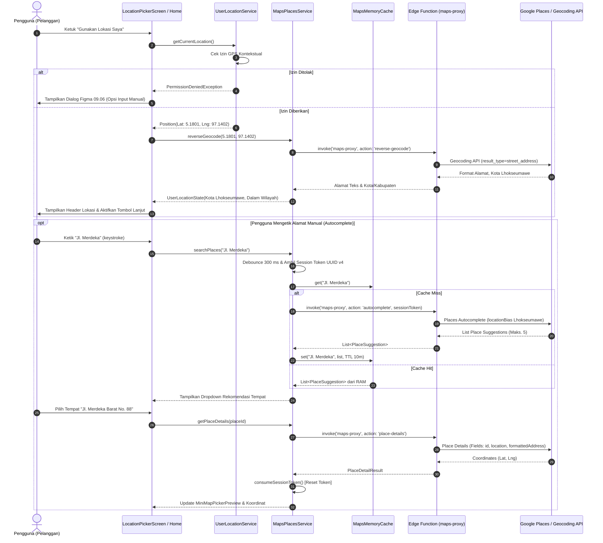
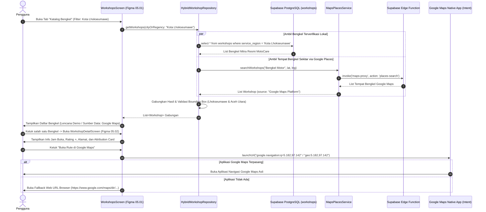
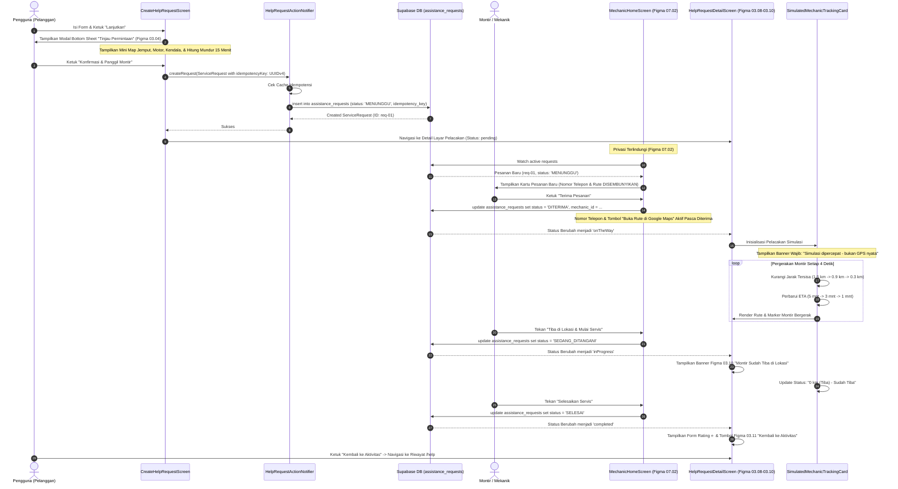
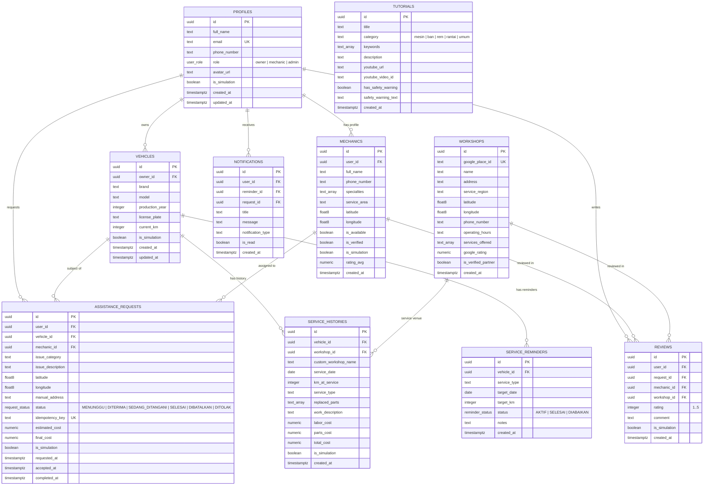

# Dokumentasi Teknis Arsitektur & Diagram Sequence Integrasi Google Maps Platform — MotoCare

Dokumen ini memuat dokumentasi arsitektur sistem menyeluruh, diagram alur sekuensial (Sequence Diagrams), skema relasi data (ERD), dan panduan deployment Supabase Edge Function untuk integrasi Google Maps Platform pada aplikasi MotoCare (Wilayah Operasional: Kota Lhokseumawe & Kab. Aceh Utara).

---

## 1. Diagram Arsitektur Integrasi Sistem

Arsitektur MotoCare mengedepankan **Keamanan Kunci (Zero-Leakage)**, **Kontrol Biaya (Cost Guard)**, dan **Ketangguhan Offline (Offline-Resilience)**:



---

## 2. Diagram Sequence Alur Utama

### 2.1 Sequence Diagram 1: Geolokasi Pengguna & Autocomplete Alamat (Figma 02.01, 03.01, 03.02)



---

### 2.2 Sequence Diagram 2: Pencarian & Detail Bengkel Hybrid (Figma 05.01, 05.02)



---

### 2.3 Sequence Diagram 3: Pembuatan Permintaan Bantuan & Pelacakan Montir Simulasi (Figma 03.04, 03.06–03.11, 07.02)



---

## 3. Entity-Relationship Diagram (ERD) PostgreSQL Supabase Live

Struktur tabel di bawah ini sesuai dengan database live Supabase proyek `acdfesajqkwbsczdiedt`:



---

## 4. Panduan Deployment Supabase Edge Function & Secrets

Edge Function `maps-proxy` bertindak sebagai reverse proxy yang memproteksi Google Maps API Server Key agar tidak terpapar ke klien.

### 4.1 Langkah Konfigurasi Rahasia (Supabase CLI)
Pastikan telah login ke akun Supabase Anda:
```bash
supabase login
supabase link --project-ref acdfesajqkwbsczdiedt
```

Simpan server API key ke dalam Supabase Vault:
```bash
supabase secrets set GOOGLE_MAPS_SERVER_KEY=AIzaSy...YourServerKeyHere
```

### 4.2 Langkah Deploy Edge Function
Deploy fungsi proxy:
```bash
supabase functions deploy maps-proxy --no-verify-jwt=false
```

*Catatan Keamanan*: `--no-verify-jwt=false` memastikan bahwa request tanpa token login Supabase yang sah akan langsung ditolak oleh Supabase Gateway sebelum memicu pemakaian kuota API Google.

